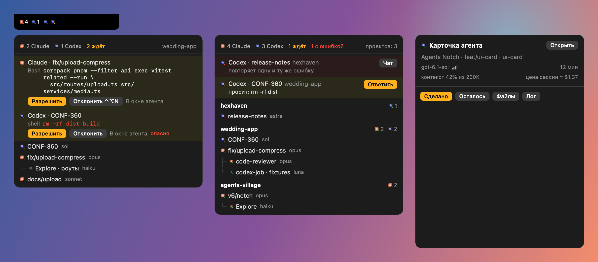

<div align="center">

Крыло слева от «чёлки» MacBook. Показывает, какие агенты Claude Code и Codex работают на этом Mac, в каких проектах и кто кого запустил. Данные берутся только из локальных журналов (`~/.claude/projects`, `~/.codex/sessions`), наружу ничего не уходит.



# Agent Notch

Одна метка на агента. Форма — вендор (кружок Claude, квадрат Codex), цвет — состояние: зелёный работает, жёлтый ждёт вас, красный застрял на ошибке, серый закончил. Субагенты мельче и прижаты к родителю.

Клик открывает список: сверху то, что требует внимания, ниже проекты и сессии с моделью и тем, что агент делает сейчас. Клик по строке открывает чат в приложении Claude или Codex, без приложения — `claude --resume` / `codex resume` в Terminal. Правый клик — меню и настройки.

## Темы

В настройках 12 тем для списка, карточки и уведомлений: Терминал, Жидкое стекло, Бумага, Полночь, Пульт, Фосфор, Синтвейв, Чертёж, Брутализм, Голограмма, Пустошь, Пиксель. У каждой свои метки агентов; в «Значках агентов» они включаются вариантом «Как в теме» и тогда видны и в крыле. Снимки всех тем — в [docs/themes](docs/themes).

## Разрешения из чёлки

С хуками запрос разрешения приходит в список со звуком и полной командой. «Разрешить» (⌃⌥Y), «Отклонить» (⌃⌥N) или «В окне агента». Опасные команды (`rm -rf`, `sudo`, `git push --force`…) и многострочные разрешаются только кликом. Без ответа за 100 секунд хук молча выходит и агент спрашивает как обычно: разрешения без клика человека не бывает. Решения пишутся в `~/Library/Application Support/AgentsNotch/decisions.jsonl`.

```bash
brew install --cask forichok/tap/agent-notch
```

Хуки добавляются в `~/.claude/settings.json` и `~/.codex/hooks.json`, чужие записи не трогаются, исходный файл сохраняется как `*.agents-notch-backup`. В Codex после установки откройте `/hooks` и отметьте `notch-hook` доверенным.

## Сборка

Нужен Xcode (Command Line Tools не подходят).

```bash
./scripts/build.sh        # build/AgentsNotch.app
./scripts/test.sh         # код выхода 0 — всё прошло
open build/AgentsNotch.app
```

Флаги: `--fixture <сцена>` (выдуманные данные), `--open-list`, `--snapshot <папка>`, `--snapshot-themes <папка>`, `--install-hooks`, `--uninstall-hooks`.

## Ограничения

- Без хуков ждущая сессия видна, но ответить из чёлки нельзя.
- На `AskUserQuestion` и согласование плана из чёлки ответить пока нельзя.
- Codex-воркеры из `codex-job` видны отдельными сессиями, без связи с родителем.
- Сжатие крыла по меню требует доступа Accessibility; после каждой пересборки его надо выдать заново (подпись ad-hoc).

## Устройство

- `Sources/NotchCore` — журналы, дерево проектов, раскладка крыла, хуки. Без AppKit.
- `Sources/NotchHook` — `notch-hook`, который запускают агенты.
- `Sources/AgentsNotch` — окно крыла, список, настройки, темы.
- `Tests/CoreChecks` — проверки на поддельных журналах.
